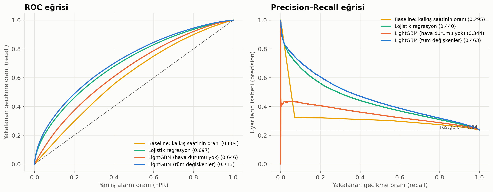
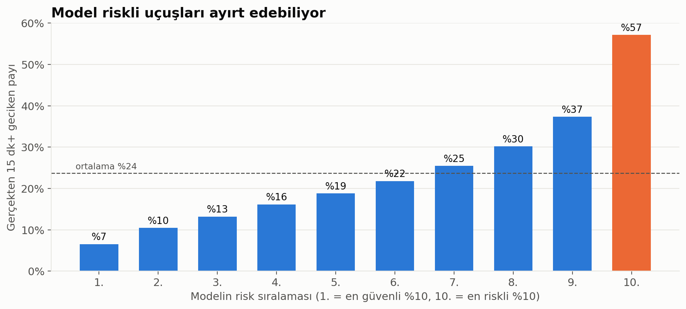
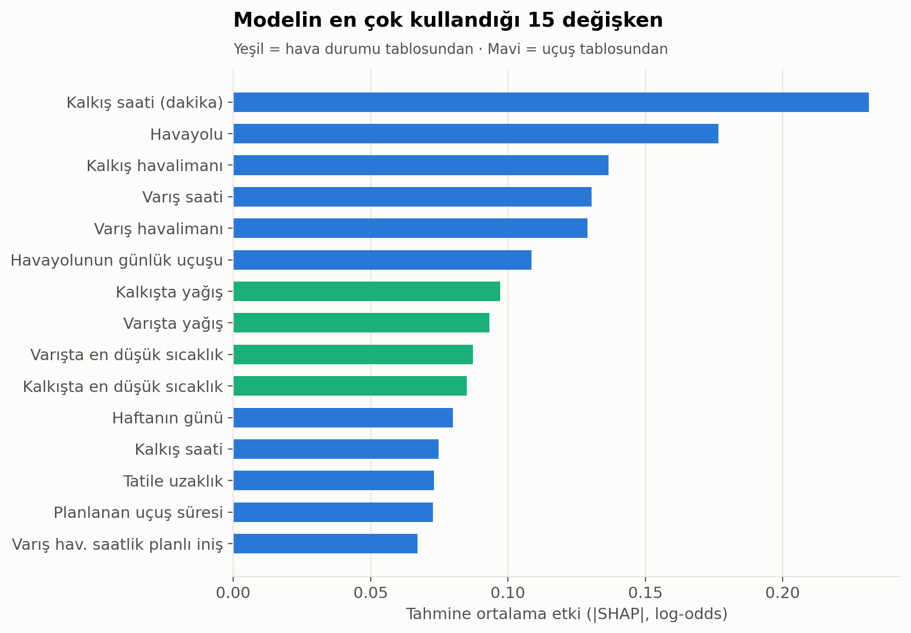

# ✈️ Flight Delay Prediction: US Domestic Flights 2025

**Will this flight arrive more than 15 minutes late?** This project predicts it before departure, using only information that is known in advance. It combines **7 million US domestic flights** with **daily weather at both the origin and destination airport**, and runs as an interactive web app.

🔗 **Live demo:** LIVE_DEMO_LINK

> Capstone project for the Workintech Data Science & Machine Learning program. Notebooks, charts and the app interface are in Turkish; this README summarizes everything in English.

## Highlights

- **Multi-table data pipeline:** 7,001,619 flights (BTS on-time data, 2025) joined with NOAA GHCN-Daily weather (22.4M measurements) through OurAirports coordinates. Each airport is matched to its nearest reliable weather station.
- **Leak-free modelling:** only pre-departure columns are used. Train, validation and test sets are split **by time**: Jan–Sep for training, Oct for validation, Nov–Dec for test.
- **LightGBM reaches ROC-AUC 0.713 and PR-AUC 0.463** on the unseen holiday months. That is 1.5× the best rule-based baseline on PR-AUC, and about 2× random.
- **Weather is the biggest single gain:** adding the weather table raises PR-AUC from 0.344 to 0.463 (**+35%**). Weather features account for **40%** of total feature importance.
- **Business value:** among the 10% of flights the model rates riskiest, **57% are actually delayed** (2.4× the average rate).
- **Deployed model:** a Streamlit app with SHAP explanations, a "what if I depart at another hour?" chart, and a weather scenario mode.

## 1. Problem & data

| Table | Source | Size |
|---|---|---|
| Flights 2025 | [Kaggle: US Flight Delays 2025 (BTS)](https://www.kaggle.com/datasets/a7madmostafa/us-flight-delays-2025-bts-on-time-performance) | 7.0M rows, 12 monthly CSVs |
| Daily weather 2025 | NOAA GHCN-Daily (AWS Open Data) | 22.4M US measurements |
| Airports | OurAirports | 352 airports, matched to weather stations |

**Target:** arrival delay > 15 min (`target_arr_del15`), the official BTS on-time definition. 22.3% of completed flights are delayed. Cancelled and diverted flights (1.7%) have no arrival time, so they are used only in the analysis, not in the model.

I framed the task as **classification**, not regression. Delays have a long tail: 60% of flights land early, while some are hours late. "Will it be late?" is also the question a passenger or an operations team actually asks.

## 2. Key insights from the EDA

| | |
|---|---|
|  |  |

- **Domino effect:** delays build up during the day. 05:00 departures are late 9% of the time; 19:00 departures are late **33%** of the time. The single biggest delay cause in BTS data, "late arriving aircraft" (39% of delay minutes), confirms this.
- **Weather:** 5 cm+ of snow at the origin raises the delay rate to **60%** (2.7× average), and 10 cm+ to 74%. Weather at the origin matters more than at the destination. With clear skies at both ends, the rate drops to 17%.
- **Riskiest time window:** summer evenings (June–July, 17:00–20:00, ≈45%). The safest are autumn mornings.
- **Airlines and airports:** there is a ~10-point gap between airlines (Hawaiian 17% vs. Frontier 28%). Among the busiest airports, DFW, DCA and ORD are the riskiest; 11 of the 15 most delayed routes are American Airlines flights out of DFW.
- **Cancellations:** 62% are caused by weather.

## 3. Modelling

| Model | ROC-AUC (test) | PR-AUC (test) |
|---|---|---|
| Random | 0.500 | 0.237 |
| Baseline: delay rate of the departure hour | 0.604 | 0.295 |
| Baseline: delay rate of airport × hour | 0.616 | 0.309 |
| Logistic regression (1M-row sample) | 0.697 | 0.440 |
| LightGBM, **without** weather | 0.646 | 0.344 |
| **LightGBM, all features** | **0.713** | **0.463** |

I used ROC-AUC and PR-AUC instead of accuracy. A model that predicts "never delayed" would score 76% accuracy while catching no delays at all.

| | |
|---|---|
|  |  |

**Threshold and business use:** the decision threshold (0.194) was chosen on the validation month by maximizing F1. On the test set this gives **61% recall and 38% precision**. The threshold can be moved depending on the use case:

| Alert on the riskiest… | Actually delayed | Lift vs. average | Share of all delays caught |
|---|---|---|---|
| 5% of flights | 66% | 2.8× | 14% |
| 10% | 57% | 2.4× | 24% |
| 20% | 47% | 2.0× | 40% |
| 30% | 42% | 1.8× | 53% |

A narrow, high-precision list suits passenger SMS alerts; a wide, high-recall list suits operations planning.



**Most important features (SHAP):** departure time, airline, origin and destination airport, the airline's daily flight volume, then precipitation and minimum temperature (frost and snow).

## 4. Error analysis & limitations

- The model separates delayed from on-time flights better **in bad weather** (AUC 0.77 on stormy days, 0.69 on normal days). On normal days, delays come mostly from operational causes the data doesn't contain, such as crew, maintenance or the previous leg.
- **Distribution shift:** the test months (Nov–Dec holiday season) have more delays than the training months. The ranking (AUC) stays solid, but predicted probabilities are too low (18% vs. 24% actual). The **deployed model is retrained on all of 2025** with the same settings; its average prediction then matches the actual rate (22.3%).
- The data has **no tail numbers**, so the strongest real-world signal, whether the same aircraft's previous flight was late, isn't available.
- The model uses **observed** daily weather. In production it should use **weather forecasts**.
- Some airlines changed during the year (e.g. Spirit's restructuring). In real use, the model should be retrained monthly.

**Next steps:** probability calibration, aircraft rotation data, forecast-based weather, scheduled retraining.

## 5. The app

The Streamlit app lets you pick an airline, a route, a date in 2025 and a departure time. It shows:
- the delay probability and risk level, compared with the average flight and the route's actual 2025 rate
- **why**: SHAP contributions grouped into readable factors
- **what if**: the predicted risk for every departure hour on the same day
- a **weather scenario mode** (snow, storms, wind…) to try out different conditions

It uses small summary tables (~10 MB in `app/assets/`) instead of the 7M-row dataset.

```bash
pip install -r requirements.txt
streamlit run app/app.py
```

## 6. Repository structure

```
notebooks/
  00_ucus_veri_kesfi.ipynb           # data download & first look, pre/post-flight column audit
  01_hava_durumu.ipynb               # NOAA weather + airport ↔ station matching
  02_temizlik_birlestirme.ipynb      # cleaning, feature engineering, join → model table
  03_eda_yorumlu.ipynb               # EDA with written insights & recommendations
  04_modelleme_yorumlu.ipynb         # baselines, logistic regression, LightGBM, ablation, threshold, SHAP, error analysis
  05_final_model_demo_dosyalari.ipynb  # final model on all of 2025 + app assets
  06_demo_calistir.ipynb             # runs the app from Colab
app/
  app.py                             # Streamlit app
  assets/                            # final LightGBM model (gzipped) + small lookup tables
figures/                             # charts used in this README
```

**Reproducing:** the notebooks run in Google Colab and read from and write to a Drive folder called `UcusGecikme/`. Run them in order (00 → 05). The raw data (~1.6 GB) is downloaded automatically by notebooks 00 and 01, so it is not stored in this repo.

## Tech
Python · DuckDB · pandas · LightGBM · scikit-learn · SHAP (LightGBM `pred_contrib`) · Matplotlib · Altair · Streamlit · Google Colab
