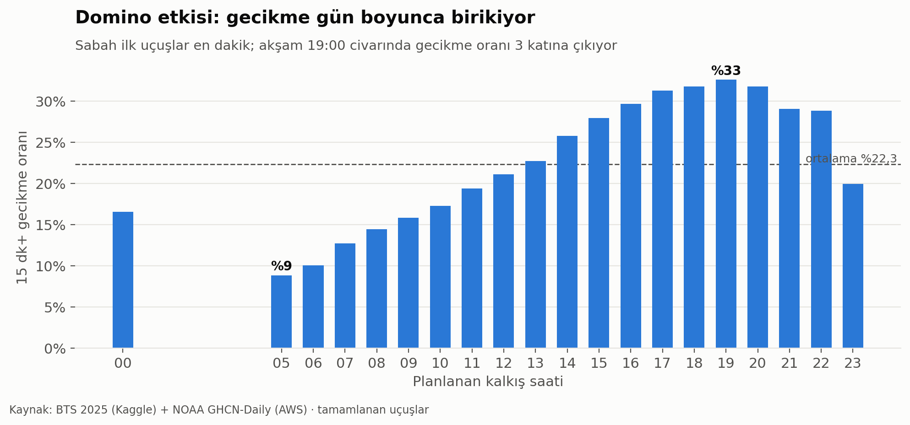
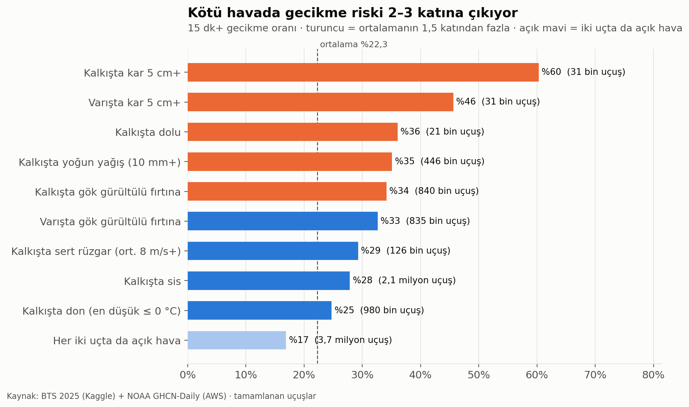

# ✈️ Flight Delay Prediction: US Domestic Flights 2025

**Will this flight arrive more than 15 minutes late?** This project predicts it before departure, using only information that is known in advance. It combines **7 million US domestic flights** with **daily weather at both the origin and destination airport**, and runs as an interactive web app.

🔗 **Live demo:** [busra-flight-delay.streamlit.app](https://busra-flight-delay.streamlit.app/) (the app may take ~30 s to wake up if nobody has used it recently)

> Capstone project for the Workintech Data Science & Machine Learning program. Notebooks, charts and the app interface are in Turkish; this README summarizes everything in English.

## Highlights

- **Multi-table data pipeline:** 7,001,619 flights (BTS on-time data, 2025) joined with NOAA GHCN-Daily weather (22.4M measurements) through OurAirports coordinates. Each airport is matched to its nearest reliable weather station.
- **Leak-free modelling:** only pre-departure columns are used. Train, validation and test sets are split **by time**: Jan–Sep for training, Oct for validation, Nov–Dec for test.
- **LightGBM reaches ROC-AUC 0.713 and PR-AUC 0.463** on the unseen holiday months. That is 1.5× the best rule-based baseline on PR-AUC, and about 2× random.
- **Weather is the biggest single gain:** adding the weather table raises PR-AUC from 0.344 to 0.463 (**+35%**). Weather features account for **40%** of total feature importance.
- **Business value:** among the 10% of flights the model rates riskiest, **57% are actually delayed** (2.4× the average rate).
- **Deployed model:** a Streamlit app with SHAP explanations, a "what if I depart at another hour?" chart, and a weather scenario mode.

## 1. Problem & data

| Table | Source | Size |
|---|---|---|
| Flights 2025 | [Kaggle: US Flight Delays 2025 (BTS)](https://www.kaggle.com/datasets/a7madmostafa/us-flight-delays-2025-bts-on-time-performance) | 7.0M rows, 12 monthly CSVs |
| Daily weather 2025 | NOAA GHCN-Daily (AWS Open Data) | 22.4M US measurements |
| Airports | OurAirports | 352 airports, matched to weather stations |

**Target:** arrival delay > 15 min (`target_arr_del15`), the official BTS on-time definition. 22.3% of completed flights are delayed. Cancelled and diverted flights (1.7%) have no arrival time, so they are used only in the analysis, not in the model.

I framed the task as **classification**, not regression. Delays have a long tail: 60% of flights land early, while some are hours late. "Will it be late?" is also the question a passenger or an operations team actually asks.

## 2. Key insights from the EDA

| | |
|---|---|
|  |  |

- **Domino effect:** delays build up during the day. 05:00 departures are late 9% of the time; 19:00 departures are late **33%** of the time. The single biggest delay cause in BTS data, "late arriving aircraft" (39% of delay minutes), confirms this.
- **Weather:** 5 cm+ of snow at the origin raises the delay rate to **60%** (2.7× average), and 10 cm+ to 74%. Weather at the origin matters more than at the destination. With clear skies at both ends, the rate drops to 17%.
